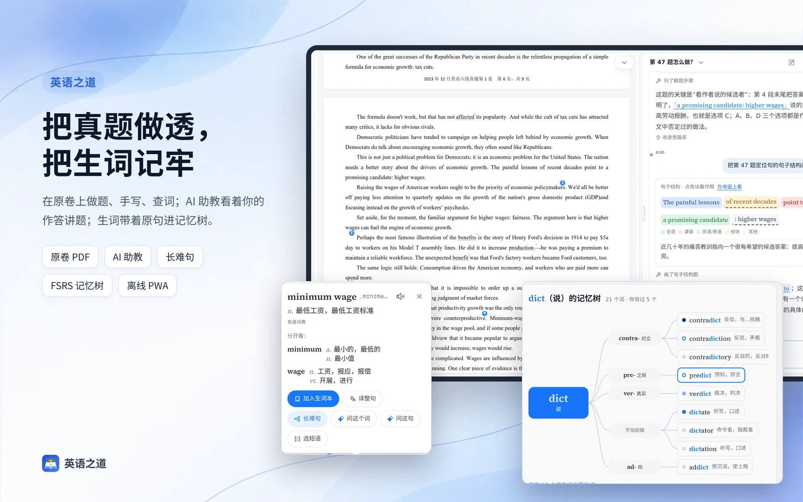
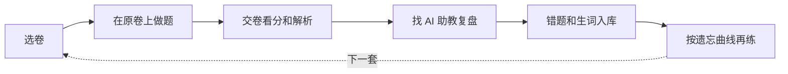
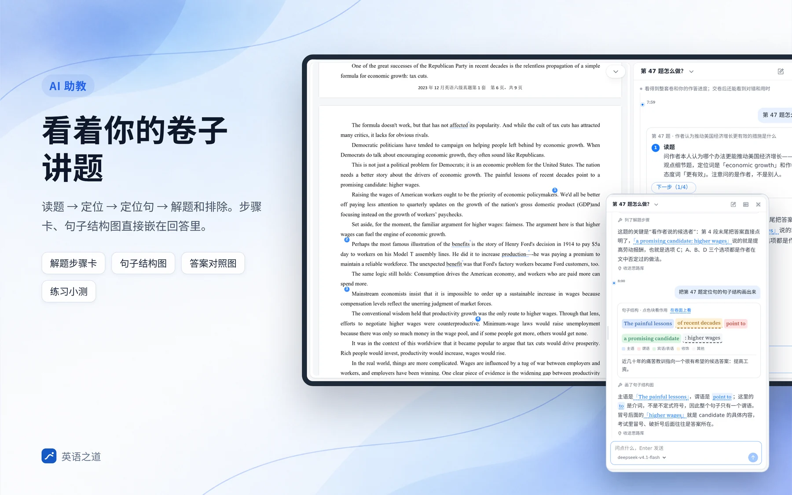
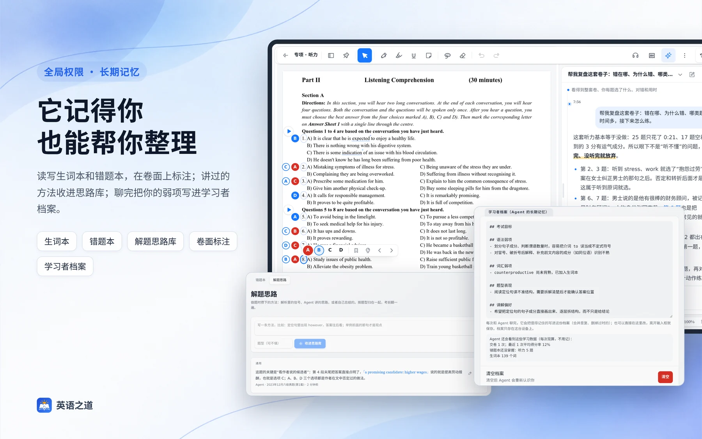
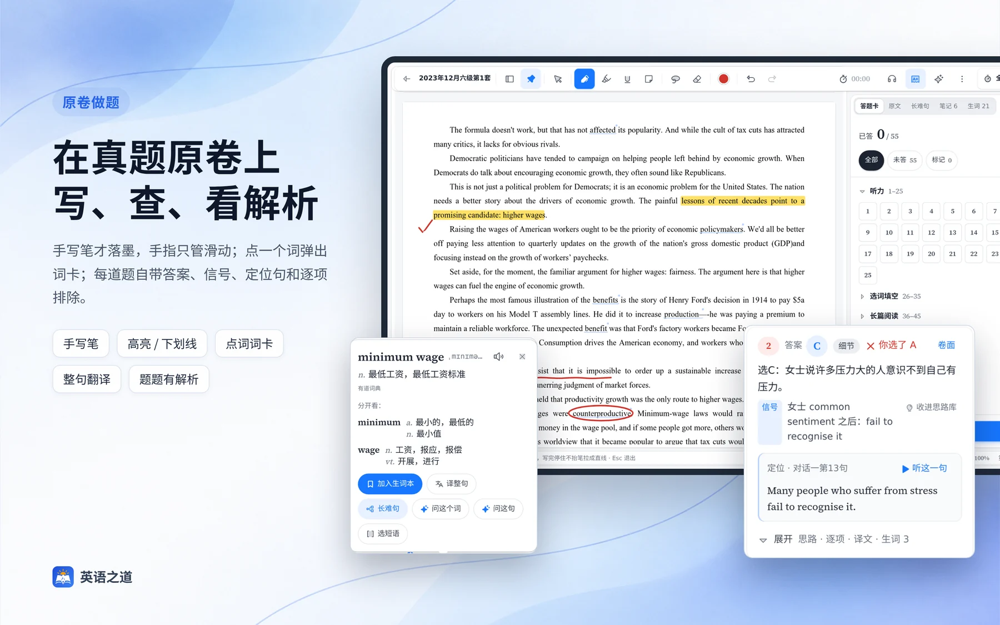
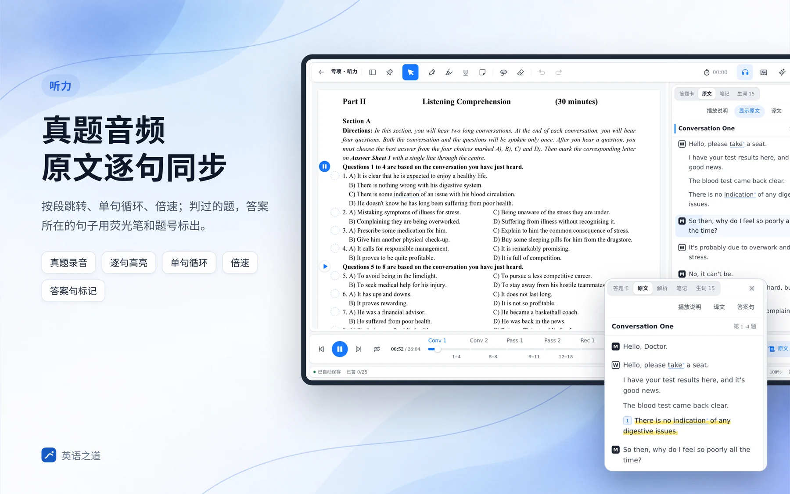
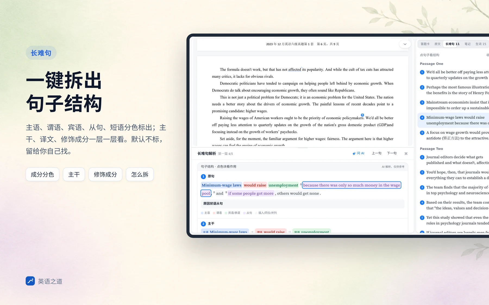
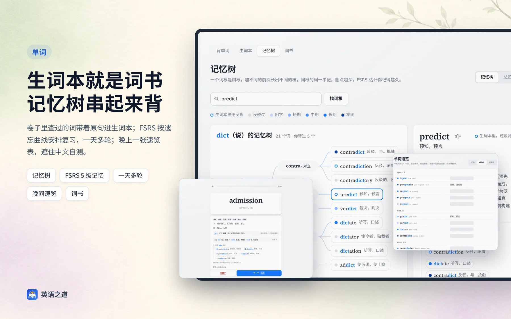
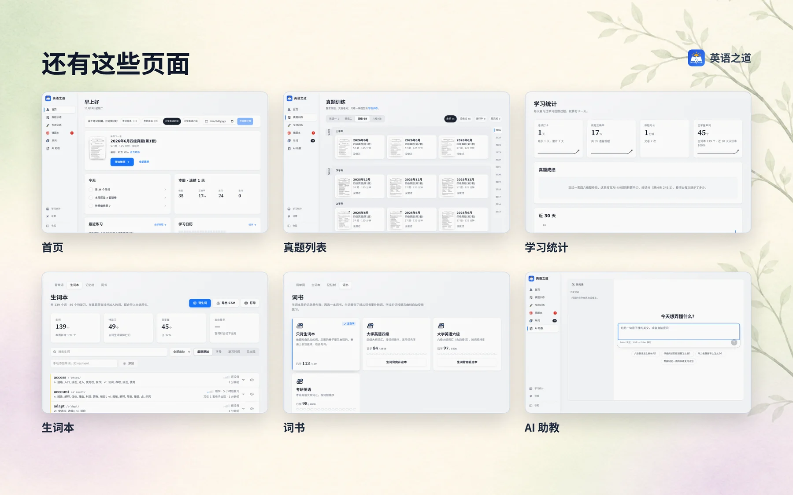

<div align="center"><a name="readme-top"></a>


# 英语之道

**把真题做透，把生词记牢。**

面向大学英语四六级和考研英语的备考应用：在原卷上做题、查词、写笔记，<br>
交卷后让 AI 助教看着你的作答复盘，卷子里碰到的生词带着原句进生词本。

[在线预览](https://yingyu-preview.vercel.app) · [功能](#功能) · [快速开始](#快速开始) · [准备数据](#准备数据) · [技术架构](#技术架构) · [常见问题](#常见问题) · [数据来源与版权](#数据来源与版权)

[](https://react.dev) [](https://www.typescriptlang.org) [](https://vite.dev) [](https://tailwindcss.com) [](https://vite-pwa-org.netlify.app) [](https://github.com/open-spaced-repetition/ts-fsrs) [](https://mozilla.github.io/pdf.js/) [](LICENSE) [](https://linux.do)

</div>

<p align="center">
  
</p>

## 亮点

<table>
<tr>
<td width="33%" valign="top">

**🤖 看着卷子讲题的 AI 助教**<br>
读题 → 定位 → 定位句 → 解题排除，回答里直接嵌结构图、步骤卡和词卡；能读写生词本、错题本，有长期记忆。

</td>
<td width="33%" valign="top">

**📄 原卷做题**<br>
原版 PDF 加文字层：点词出卡片，手写笔圈画，荧光笔高亮，每题自带解析，听力原文逐句同步。

</td>
<td width="33%" valign="top">

**🌳 记忆树背单词**<br>
生词本就是词书。同根、短语、易混三根枝串起来背，FSRS 安排复习，一天多轮，晚上一张速览表。

</td>
</tr>
<tr>
<td valign="top">

**🎯 专项训练**<br>
从任意一套真题里只练听力、阅读、翻译或写作，单独计分，错题自动进错题本。

</td>
<td valign="top">

**🧩 长难句一键解析**<br>
默认不标，留给自己找；想对照时一键标出，主干、从句、修饰成分分色拆开。

</td>
<td valign="top">

**📴 本地优先、离线可用**<br>
作答、笔记、生词和复习进度存在浏览器里；装成 PWA，没网也能做打开过的卷子。

</td>
</tr>
</table>

<details>
<summary><b>目录</b></summary>

- [为什么做这个](#为什么做这个)
- [功能](#功能)
  - [AI 助教](#ai-助教) · [原卷做题](#原卷做题) · [听力](#听力) · [专项训练和错题本](#专项训练和错题本) · [长难句结构解析](#长难句结构解析) · [背单词：记忆树](#背单词记忆树) · [更多页面](#更多页面)
- [适配](#适配)
- [技术架构](#技术架构)
- [快速开始](#快速开始)
  - [准备数据](#准备数据) · [常用命令](#常用命令) · [部署 AI 助教（可选）](#部署-ai-助教可选)
- [目录结构](#目录结构)
- [常见问题](#常见问题)
- [参与贡献](#参与贡献)
- [数据来源与版权](#数据来源与版权)
- [致谢](#致谢)

</details>

## 为什么做这个

备考英语四六级、考研，常见的做法是：题在一个 App 里刷，词在另一个 App 里背，不会的句子再去问 AI。三者之间互不相通：背的词不是卷子里碰到的，问 AI 时要把题目、选项和自己的答案再抄一遍。

英语之道只围绕一套真题转：



- **原卷就是界面**：每套卷子都按原版 PDF 显示，不改写成网页题目。点词查词、点题号选答案、用笔在卷面上写。
- **AI 看得到你的上下文**：助教能看到当前文章、题目、你的作答、对错、每题用时和卷面笔记，能读写生词本和错题本，还记得你的薄弱点，不用复制粘贴。
- **生词本就是词书**：在卷子里查过的词带着原句进生词本，之后再出现在别的卷子里会被标出来。
- **数据在本地**：做题记录、笔记、生词和复习进度都存在浏览器的 IndexedDB 里，可以离线使用，也能导出备份。

## 功能

### AI 助教



在卷子旁边分屏打开。它看得到整套卷子和你的作答，问「第 47 题怎么做」，回答里直接嵌一张解题步骤卡，按固定顺序一步一步点开：

1. **读题**：这道题问什么，属于哪类题；
2. **定位**：去文章哪里找，关键词是什么；
3. **定位句**：把原文句子引出来并解释；
4. **解题和排除**：为什么选这个，其他选项错在哪。

**嵌在回答里的可视化**：解题步骤卡、句子结构图（按成分分色，点色块看作用）、定位句和选项的对照图、词汇卡、练习小测。在回答里选中英文词或短语可以加进生词本，任何一段都能收进解题思路库。



**能读写全局数据**，不用复制粘贴：

| 范围 | 能做什么 |
|---|---|
| 试卷 | 读当前文章、段落、题目、你的作答、对错、每题用时和卷面笔记；在卷面上标注、标出长难句 |
| 生词本 | 查词、列出生词本、加词、改释义、删词、标记已掌握 |
| 错题本 | 加入错题，按题型统计薄弱点 |
| 解题思路库 | 把讲过的方法收进去，按题型归类，考前翻一遍 |
| 学习者档案 | 聊完自动改写长期记忆 |

- **交卷复盘**：交卷单上点「找 Agent 复盘」，它按对错和每题用时讲错在哪、接下来怎么练。
- **长期记忆**：一份学习者档案，写着考试目标、语法和词汇弱项、题型表现、喜欢的讲法。每次聊完由模型合并改写，在设置里能直接改或清空。每次对话还会带上从本机数据现算的学习情况：交卷次数、平均分、没掌握的错题、生词数。

档案和对话都存在你自己的浏览器里。后端是一个只用 Python 标准库的小服务，转发到任意 OpenAI 兼容接口（DeepSeek、Gemini 等），密钥只放在服务器上。

### 原卷做题



- **原卷 PDF**，带文字层：点一个词弹出词卡（自动还原词形，studies → study），有音标、发音、释义和拆法；框选几个词查短语或整句翻译。
- **生词自动标记**：生词本里的词和短语，在之后的每套卷子里都会标出来。
- **手写笔记**：只有手写笔能写，手指用来滑动；支持压感、荧光笔高亮、下划线、便签、套索和橡皮擦，可撤销重做。
- **题题有解析**：答案、题型、你选的，「信号」是解题线索，可收进思路库；下面是定位句，再展开是思路、逐项排除、译文和生词。
- **两种模式**：普通做题随时能看解析；全真模拟计时，交卷后才能看。点题号或完形空位选答案，交卷按四六级官方规则折算分数。

#### 听力



真题录音配播放器：播放暂停、倍速、按段跳转、单句循环。原文逐句同步高亮，判过的题，答案所在的那句用荧光笔标出，句首有题号，点题号回到卷面上这道题。打开「答案句」开关，没做的题也能标出位置，但不给答案。每句都能单独看译文；听力题的解析里能直接听定位句。

### 专项训练和错题本


- **专项训练**：从任意一套真题里只截取一个部分练：听力、选词填空、长篇阅读、仔细阅读、翻译、写作，和整卷分开计分，可选考试模式或练习模式。
- **交卷单**：得分、用时、错题一览，可以看解析、只重做错题，或找 Agent 复盘。
- **错题本**：错题自动进来，按题型统计，掌握了就移出。

### 长难句结构解析



默认不标，留给自己找。想对照时在右侧「长难句」里一键解析：卷面句首出现编号，点开是结构卡片，主语、谓语、宾语、从句、短语分色标出，下面是主干、译文、每个修饰成分修饰谁，以及怎么拆。也可以在卷面上选任意一句让 AI 现场分析。

### 背单词：记忆树



- **记忆树**：词根是树干，前缀是分叉，同根词是叶子，圆点颜色是你对每个词的记忆程度。点一个词，看它怎么拼出来（pre 之前 + dict 说 → 预知）、词源，以及同根、短语、易混三根枝：没有词根的词（take、look）靠短语枝记搭配，易混词（adapt / adopt、affect / effect）带区分要点。
- **生词本是主词书**：在卷子里查过的词带着真题出处和原句进生词本，之后再出现在别的卷子里会被标出来。
- **FSRS 调度**：用 [ts-fsrs](https://github.com/open-spaced-repetition/ts-fsrs) 按遗忘曲线安排复习。按「不复习能记多久」，每个词分刚学、短期、中期、长期、牢固 5 个记忆等级。
- **提示阶梯**：想不起来先要提示，第一次只给拆法（ad + miss + ion），第二次给每块的意思。
- **一天多轮**：默认每天 3 轮（早、中、晚），可设 1–5 轮。第一轮正式复习并评分；之后几轮「快速过」，只是多看几遍，不改复习安排。
- **晚间速览**：当天的词按同根、易混、后缀规则排成一张表，可以遮住中文或英文，逐格点开自测。
- **词书**：四级、六级、考研大纲词表，按每日计划加入新词；约 6000 个词带美音、英音真人发音，离线可播。

### 更多页面



首页推荐下一套卷子和今天要做的事；真题列表按考试和年份排；学习统计看每天背词、做题和真题成绩；AI 助教也能单独打开，直接贴一句英文问。

<div align="right"><a href="#readme-top">↑ 回到顶部</a></div>

## 适配

- **平板优先**：按平板横屏手写做题设计。
- **PWA**：可以安装到桌面；应用和词典数据离线缓存，没网也能做已打开过的卷子、背词。
- **手指和笔分开**：手指滑动翻页，手写笔才落墨，不会滑一下就画一道。

<div align="right"><a href="#readme-top">↑ 回到顶部</a></div>

## 技术架构

```
浏览器（PWA）
├── React 19 + React Router，页面按路由懒加载
├── PDF.js           原卷渲染与文字层，单词坐标用于查词、长难句定位
├── Dexie/IndexedDB  作答、笔记、生词、FSRS 卡片、AI 长期记忆
├── ts-fsrs          间隔重复调度
├── Workbox          离线缓存（应用、词典、已打开的试卷）
└── Grasso           自有设计系统（src/grasso/，token 由脚本生成）

服务器（可选，只有 AI 助教需要）
├── nginx            静态文件 + 反向代理 /api/agent/、/admin
└── server/agent_server.py   Python 标准库，转发 OpenAI 兼容接口，带管理后台
```

不配服务器也能用全部做题和背词功能，只是没有 AI 助教。

<div align="right"><a href="#readme-top">↑ 回到顶部</a></div>

## 快速开始

需要 Node.js 20 以上。

```bash
git clone https://github.com/luohui1/CETPath.git
cd CETPath
npm install
npm run dev
```

> [!IMPORTANT]
> 仓库里**只有应用源码**，不含试卷、音频和词典数据（`public/papers/`、`public/audio/`、`public/dict/` 都在 `.gitignore` 里）。clone 下来能跑起界面，但没有卷子可做。要用完整功能，需要自己准备数据，见下一节。

### 准备数据

| 数据 | 放在哪 | 怎么来 |
| --- | --- | --- |
| 词典 | `public/dict/` | 下载 [ECDICT](https://github.com/skywind3000/ECDICT) 的 `ecdict.csv` 放到 `data/raw/ecdict/`，运行 `npm run build:dict` |
| 词根词缀 | `public/dict/roots/` | 把 [OpenEtymology](https://github.com/openetymology/OpenEtymology) 的 5 本 EPUB 放到 `data/raw/openetymology/`，运行 `npm run build:roots` |
| 试卷 | `public/papers/` | 用导入脚本把你**有权使用**的真题 PDF 转成原卷数据，见下表；格式见 [docs/试卷数据格式.md](docs/试卷数据格式.md) |
| 听力与发音 | `public/audio/` | 四六级听力 MP3 由 `npm run import:cet` 随试卷一起导入；单词发音见 `npm run fetch:word-audio` |

### 常用命令

| 命令 | 作用 |
| --- | --- |
| `npm run dev` | 开发服务器；`npm run dev:lan` 让局域网里的平板也能打开 |
| `npm run build` | 类型检查并打包到 `dist/` |
| `npm run preview` | 本地预览打包结果 |
| `npm run check:papers` | 校验试卷 JSON，重新生成试卷目录 `index.json` |
| `npm run inspect:pdf -- 文件.pdf` | 检查一份 PDF 能不能直接导入：有没有文字层、是不是乱码、像哪种考试 |
| `npm run import:cet` | 把 `organize:cet` 整理好的四六级真题、解析和听力导入成原卷数据 |
| `npm run import:kaoyan -- 2019` | 导入考研英语（一）真题和答案 PDF（去水印、定位题号和单词） |
| `npm run import:sample` | 从考试院大纲 PDF 导入四级官方样卷；六级用 `python -I scripts/import_neea_sample.py cet6` |
| `npm run organize:cet` | 把四六级资料包整理成按考试、年月归档的真题库 |
| `npm run thumbs` | 生成每套卷子第一页的缩略图 |
| `npm run polish:explain` | 整理导入时带的解析，写到解析层 `public/papers/explain/` |
| `npm run align:transcripts` | 听力原文逐句对齐音频 |
| `npm run build:dict` | 从 ECDICT 生成词典数据，按首字母分片按需加载 |
| `npm run build:roots` | 生成词根词缀、同根词数据 |
| `npm run fetch:word-audio` | 下载词书单词的真人发音（非官方接口，对外发布前要换有授权的来源） |

### 部署 AI 助教（可选）

```bash
python3 server/agent_server.py set-password   # 第一次：设管理后台密码
python3 server/agent_server.py serve          # 只听 127.0.0.1:8787
```

用 nginx 把 `/api/agent/`、`/api/admin/`、`/admin` 转发到这个端口，然后打开 `/admin` 填接口地址、模型名和密钥。示例配置在 [`deploy/nginx.conf`](deploy/nginx.conf) 和 [`deploy/yingyu-agent.service`](deploy/yingyu-agent.service)。配置文件路径由环境变量 `YZ_AGENT_CONFIG` 指定。

> [!WARNING]
> 没设激活码时，任何能打开网站的人都能用 AI 助教，费用记在你的接口账户上。公开部署时，请在 `/admin` 里设一个激活码（学习者在设备上输一次即可），或者在 nginx 上限制访问。

<div align="right"><a href="#readme-top">↑ 回到顶部</a></div>

## 目录结构

```
src/
  pages/        页面（首页、真题、做题、背词、生词本、记忆树、统计、设置…）
  exam/         做题页：卷面、答题卡、笔记、长难句、AI 分屏
  review/       拼写卡、单词的真题原句语境
  components/   可复用组件（查词卡片、听力播放器、记忆树…）
  lib/          数据库、词典、FSRS、词根、试卷类型、AI 接口
  grasso/       设计系统
server/         AI 助教后端（Python 标准库）
scripts/        数据导入、生成和校验脚本
deploy/         nginx 和 systemd 示例配置
docs/           设计文档、试卷数据格式、截图
```

<div align="right"><a href="#readme-top">↑ 回到顶部</a></div>

## 常见问题

<details>
<summary><b>clone 下来为什么没有卷子？</b></summary>

真题、听力和解析有版权，仓库只放源码。按 [准备数据](#准备数据) 导入你有权使用的资料即可。

</details>

<details>
<summary><b>不配 AI 后端能用吗？</b></summary>

能。做题、查词、笔记、解析、听力、背词都在浏览器里完成，只有 AI 助教和长难句的现场分析需要后端。

</details>

<details>
<summary><b>支持哪些模型？</b></summary>

任何 OpenAI 兼容接口都行，比如 DeepSeek、Gemini。在 `/admin` 里填接口地址、模型名和密钥，密钥只存在服务器上。

</details>

<details>
<summary><b>数据存在哪？换设备怎么办？</b></summary>

默认存在浏览器的 IndexedDB 里。设置页可以导出、导入备份；部署了后端的话，登录账号后会自动同步。

</details>

<details>
<summary><b>手机能用吗？</b></summary>

能打开，但界面按平板横屏手写做题设计，手机上更适合背单词和看速览。

</details>

## 参与贡献

欢迎提 Issue 和 Pull Request。提交前请跑一遍：

```bash
npx tsc -b && npm run build
```

- 界面组件用 `src/grasso/` 里的设计系统，不另起一套样式。
- 新的数据脚本放在 `scripts/`，生成的数据不要提交（`public/papers/`、`public/audio/`、`public/dict/` 都在 `.gitignore` 里）。
- 不要提交任何真题 PDF、音频或从题库网站下载的资料。

## 数据来源与版权

| 内容 | 来源 | 协议 |
| --- | --- | --- |
| 词典释义、音标 | [ECDICT](https://github.com/skywind3000/ECDICT) | MIT |
| 词根词缀、词源 | [OpenEtymology](https://github.com/openetymology/OpenEtymology) | CC BY-SA 4.0 |
| 易混词辨析（82 组） | [Lexkite confused-words-dataset](https://github.com/lexkiteapp/confused-words-dataset) | CC BY 4.0 |
| 形近词（约 750 对） | 从词书按拼写差异自动挑出 | — |
| 长难句解析、部分题目解析 | 大模型生成，界面上标注「AI 生成，仅供参考」 | — |

- **真题有版权**。仓库不分发任何试卷、音频或解析；请只导入你有权使用的资料，公开部署前需要取得授权。
- **不要**使用从其他题库网站抓取或下载的题库、PDF、音频和解析。
- AI 生成的解析经过格式校验和抽查，但没有逐句人工核对，可能有错。
- 单词真人发音脚本使用的是非官方接口，只适合个人开发；对外发布前要换成有授权的来源。

## 致谢

- [LINUX DO](https://linux.do)：新的理想型社区
- [ECDICT](https://github.com/skywind3000/ECDICT)：英汉词典数据
- [OpenEtymology](https://github.com/openetymology/OpenEtymology)：词根词缀和词源
- [Lexkite confused-words-dataset](https://github.com/lexkiteapp/confused-words-dataset)：易混词辨析
- [ts-fsrs](https://github.com/open-spaced-repetition/ts-fsrs)：FSRS 间隔重复算法
- [PDF.js](https://github.com/mozilla/pdf.js)、[Dexie.js](https://github.com/dexie/Dexie.js)、[Workbox](https://github.com/GoogleChrome/workbox)

## 开源协议

本仓库源码采用 [MIT License](LICENSE) 开源（不含第三方词典与真题版权素材，详见上文「数据来源与版权」）。

## 截图说明

README 里的界面都是真实截图，卷面是 2023 年 12 月大学英语六级第 1 套；生词、记忆进度等学习数据是演示用的示例数据；AI 助教的回答是线上模型（deepseek-v4.1-flash）当场生成的，没有改动。宣传图的浅色背景由图像模型生成，界面部分没有用生图改动。

<div align="right"><a href="#readme-top">↑ 回到顶部</a></div>
