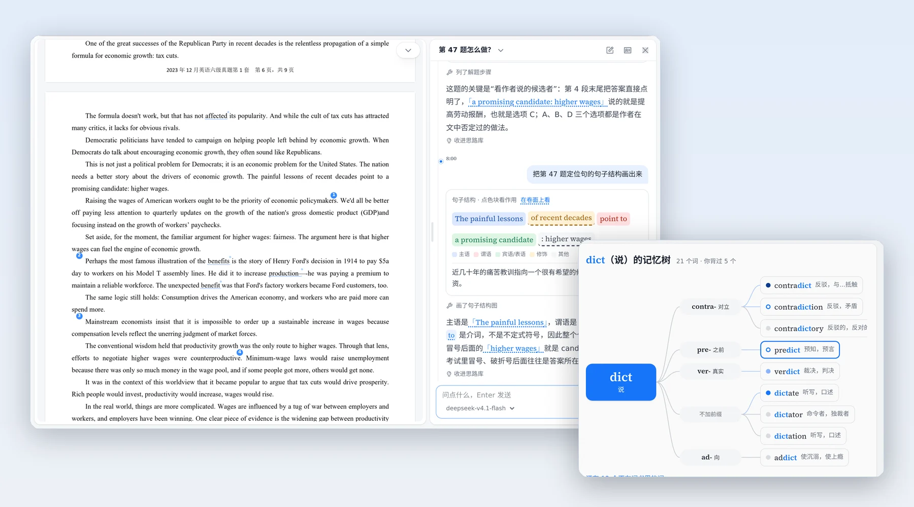
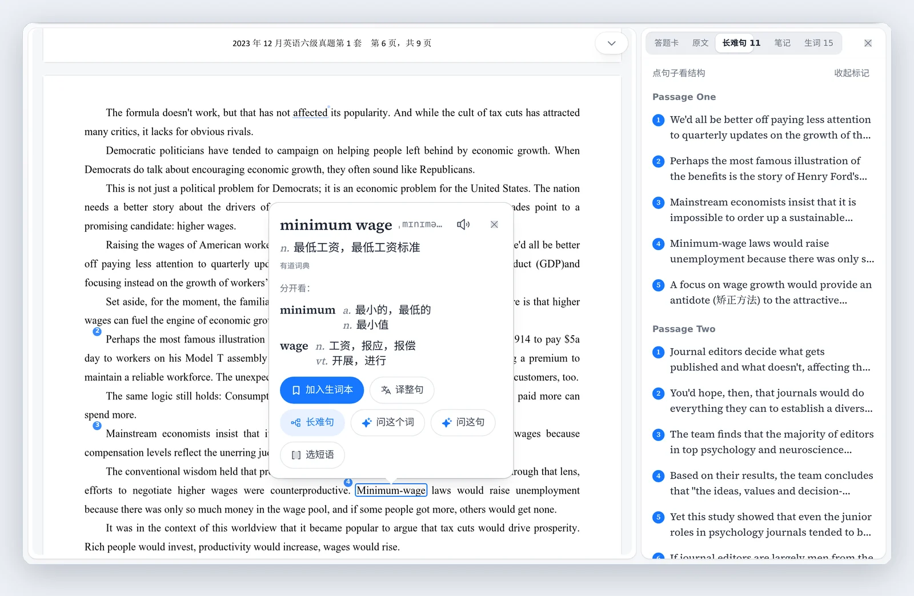
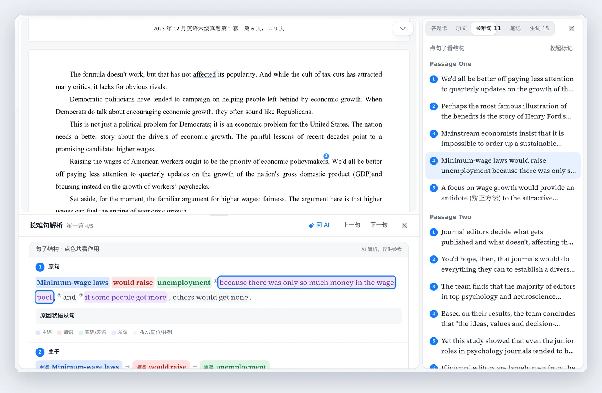
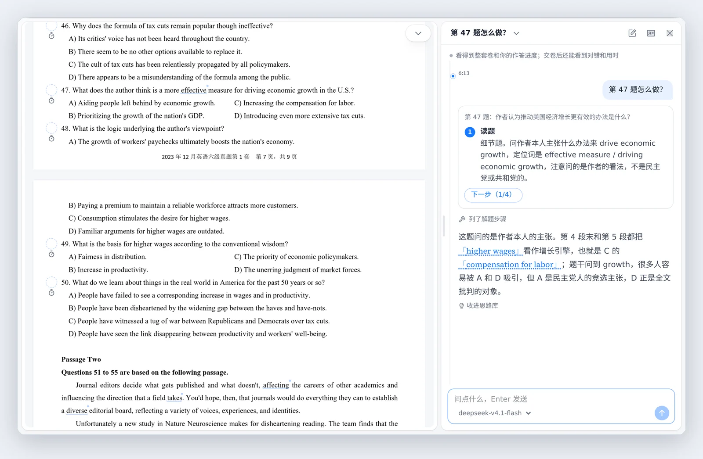
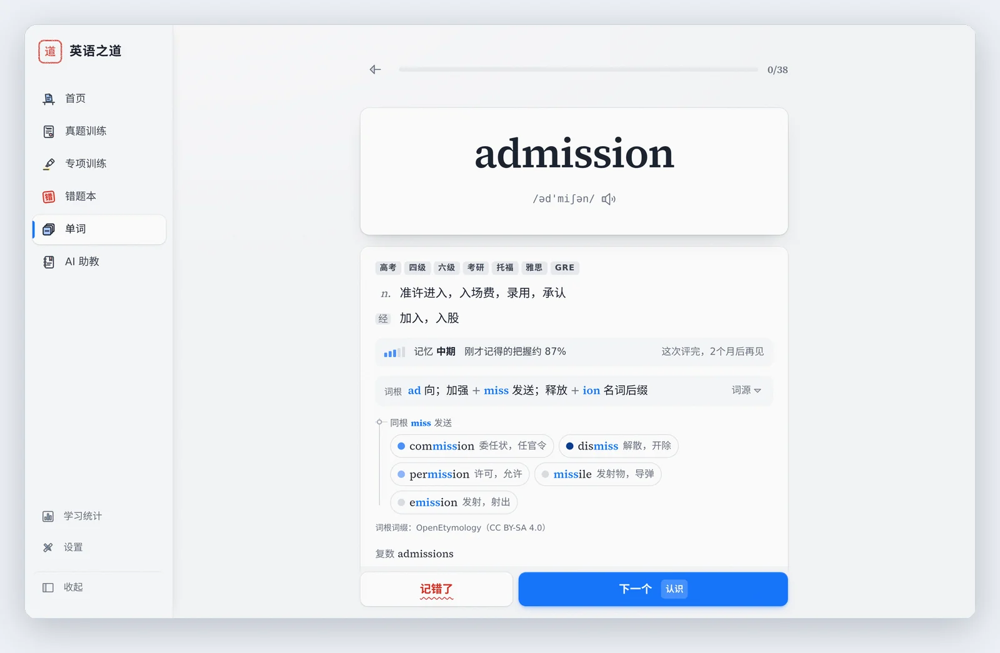
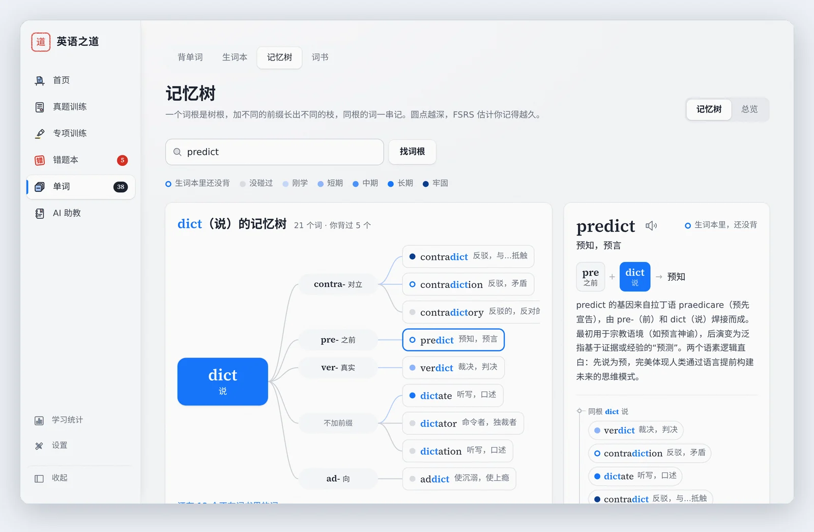
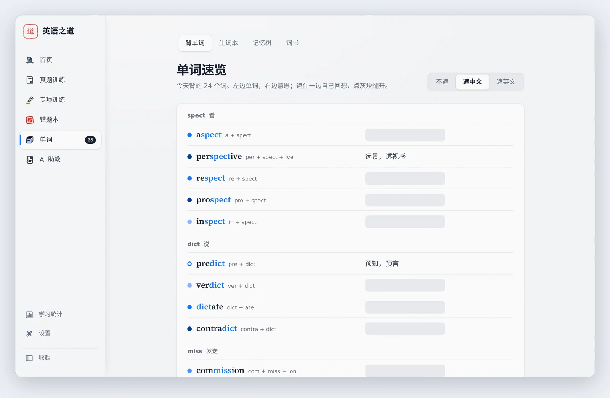
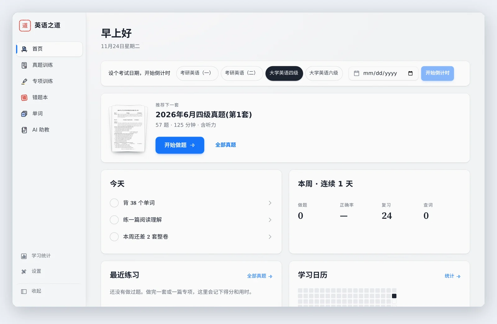
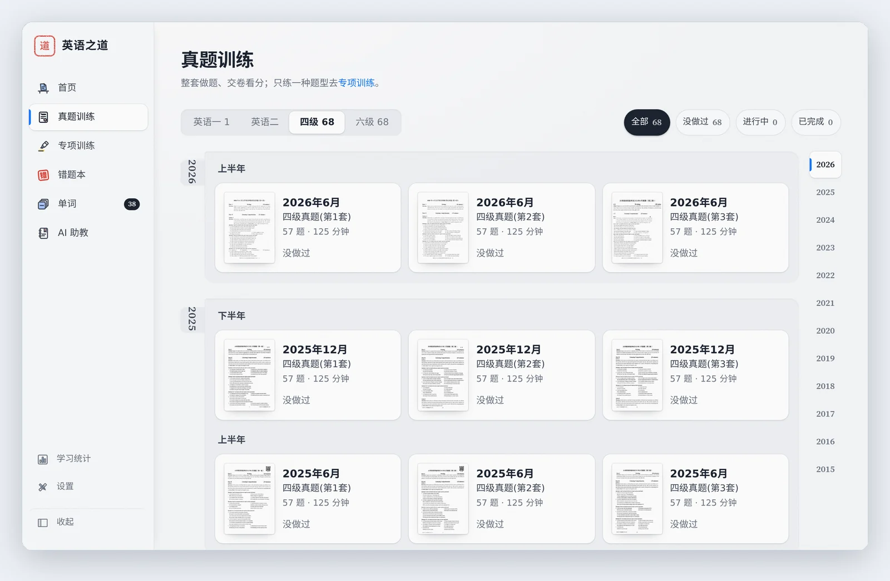

<div align="center">


# 英语之道

**把真题做透，把生词记牢。**

在原卷上做题、查词、写笔记；交卷后让 AI 助教看着你的作答复盘；<br>
卷子里碰到的生词带着原句进生词本，按遗忘曲线和词根结构背。

React · TypeScript · Vite · PWA · IndexedDB · PDF.js · FSRS

</div>

<p align="center">
  
</p>

## 为什么做这个

备考英语四六级、考研，常见的做法是：题在一个 App 里刷，词在另一个 App 里背，不会的句子再去问 AI。三者之间互不相通：背的词不是卷子里碰到的，问 AI 时要把题目、选项和自己的答案再抄一遍。

英语之道只围绕一套真题转：

```
选卷 → 在原卷上做题 → 交卷看分和解析 → 找 AI 助教复盘 → 错题和生词入库 → 按遗忘曲线再练
```

- **原卷就是界面**：每套卷子都按原版 PDF 显示，不改写成网页题目。点词查词、点题号选答案、用笔在卷面上写。
- **AI 看得到你的上下文**：助教能看到当前文章、题目、你的作答、对错、每题用时和卷面笔记，不用复制粘贴。
- **生词本就是词书**：在卷子里查过的词带着原句进生词本，之后再出现在别的卷子里会被标出来。
- **数据在本地**：做题记录、笔记、生词和复习进度都存在浏览器的 IndexedDB 里，可以离线使用，也能导出备份。

## 功能

### 原卷做题



- 原卷 PDF 渲染，带文字层：点一个词查词（自动还原词形，studies → study），框选几个词查短语或整句翻译。
- 点题号或完形空位选答案，所选的词直接填进空位；交卷判分，按四六级官方规则折算分数。
- 手写笔记：只有手写笔能写，手指用来滑动；支持压感、高亮、下划线、便签和橡皮擦，可撤销重做。
- 听力播放器：按段跳转、单段循环、倍速，原文逐句同步高亮。
- 两种模式：普通做题随时能看解析；全真模拟计时，交卷后才能看。
- 专项训练：只截取原卷的一个部分练，比如只练仔细阅读，和整卷分开计分。

### 长难句结构解析



默认不标，留给自己找。想对照时在右侧「长难句」里一键解析：卷面句首出现编号，点开是结构卡片，主语、谓语、宾语、从句、短语分色标出，下面是主干、译文、每个修饰成分修饰谁，以及怎么拆。也可以在卷面上选任意一句让 AI 现场分析。

### AI 助教



在卷子旁边分屏打开，问「第 47 题怎么做」，它按固定的顺序讲：

1. **读题**：这道题问什么，属于哪类题；
2. **定位**：去文章哪里找，关键词是什么；
3. **定位句**：把原文句子划出来并解释；
4. **解题和排除**：为什么选这个，其他选项错在哪。

助教会记住你的薄弱点（长期记忆存在你自己的浏览器里，可在设置里查看、修改、清空）。后端是一个只用 Python 标准库的小服务，转发到任意 OpenAI 兼容接口（DeepSeek、Gemini 等），密钥只放在服务器上。

### 背单词

<table>
<tr>
<td width="50%"></td>
<td width="50%"></td>
</tr>
<tr>
<td><b>背词卡片</b>：想不起来先要提示，第一次只给拆法（ad + miss + ion），第二次给每块的意思。背面是释义、记忆等级、词根和同根词。</td>
<td><b>记忆树</b>：词根是树干，前缀是分叉，同根词是叶子；圆点颜色是你对每个词的记忆程度。没有词根的词长「短语」枝，易混词长「辨析」枝。</td>
</tr>
</table>

- **FSRS 调度**：用 [ts-fsrs](https://github.com/open-spaced-repetition/ts-fsrs) 按遗忘曲线安排复习。按 FSRS 估计的「不复习能记多久」，每个词分刚学、短期、中期、长期、牢固 5 个记忆等级。
- **一天多轮**：默认每天 3 轮（早、中、晚），可设 1–5 轮。第一轮正式复习并评分；之后几轮「快速过」，只是多看几遍，不改复习安排。
- **晚间速览**：当天的词按同根、易混、后缀规则排成一张表，左边单词右边释义，可以遮住中文或英文，逐格点开自测。
- **生词本**：自动记录真题出处和原句，按试卷筛选、搜索，导出 CSV 或打印。
- **词书**：四级、六级、考研大纲词表，按每日计划加入新词；约 6000 个词带美音、英音真人发音，离线可播。

<p align="center">
  
</p>

### 更多页面

<table>
<tr>
<td width="50%"></td>
<td width="50%"></td>
</tr>
<tr>
<td><b>首页</b>：推荐下一套卷子、今天要背的词和该练的题型，以及考试倒计时。</td>
<td><b>真题列表</b>：按考试和年份排，显示每套卷子的进度。</td>
</tr>
</table>

另外还有错题本、学习统计（打卡热力图、正确率、复习量）和设置（发音、倒计时、数据备份）。

## 适配

- **平板优先**：主要按平板横屏手写做题设计，竖屏和手机也能用。
- **PWA**：可以安装到桌面或手机主屏；应用和词典数据离线缓存，没网也能做已打开过的卷子、背词。
- **手指和笔分开**：手指滑动翻页，手写笔才落墨，不会滑一下就画一道。

## 技术架构

```
浏览器（PWA）
├── React 19 + React Router，页面按路由懒加载
├── PDF.js           原卷渲染与文字层，单词坐标用于查词、长难句定位
├── Dexie/IndexedDB  作答、笔记、生词、FSRS 卡片、AI 长期记忆
├── ts-fsrs          间隔重复调度
├── Workbox          离线缓存（应用、词典、已打开的试卷）
└── Grasso           自有设计系统（src/grasso/，token 由脚本生成）

服务器（可选，只有 AI 助教需要）
├── nginx            静态文件 + 反向代理 /api/agent/、/admin
└── server/agent_server.py   Python 标准库，转发 OpenAI 兼容接口，带管理后台
```

不配服务器也能用全部做题和背词功能，只是没有 AI 助教。

## 快速开始

需要 Node.js 20 以上。

```bash
git clone https://github.com/luohui1/yingyu-zhidao.git
cd yingyu-zhidao
npm install
npm run dev
```

> [!IMPORTANT]
> 仓库里**只有应用源码**，不含试卷、音频和词典数据（`public/papers/`、`public/audio/`、`public/dict/` 都在 `.gitignore` 里）。clone 下来能跑起界面，但没有卷子可做。要用完整功能，需要自己准备数据，见下一节。

### 准备数据

| 数据 | 放在哪 | 怎么来 |
| --- | --- | --- |
| 词典 | `public/dict/` | 下载 [ECDICT](https://github.com/skywind3000/ECDICT) 的 `ecdict.csv` 放到 `data/raw/ecdict/`，运行 `npm run build:dict` |
| 词根词缀 | `public/dict/roots/` | 把 [OpenEtymology](https://github.com/openetymology/OpenEtymology) 的 5 本 EPUB 放到 `data/raw/openetymology/`，运行 `npm run build:roots` |
| 试卷 | `public/papers/` | 用导入脚本把你**有权使用**的真题 PDF 转成原卷数据，见下表；格式见 [docs/试卷数据格式.md](docs/试卷数据格式.md) |
| 听力与发音 | `public/audio/` | 四六级听力 MP3 由 `npm run import:cet` 随试卷一起导入；单词发音见 `npm run fetch:word-audio` |

### 常用命令

| 命令 | 作用 |
| --- | --- |
| `npm run dev` | 开发服务器；`npm run dev:lan` 让局域网里的平板也能打开 |
| `npm run build` | 类型检查并打包到 `dist/` |
| `npm run preview` | 本地预览打包结果 |
| `npm run check:papers` | 校验试卷 JSON，重新生成试卷目录 `index.json` |
| `npm run inspect:pdf -- 文件.pdf` | 检查一份 PDF 能不能直接导入：有没有文字层、是不是乱码、像哪种考试 |
| `npm run import:cet` | 把 `organize:cet` 整理好的四六级真题、解析和听力导入成原卷数据 |
| `npm run import:kaoyan -- 2019` | 导入考研英语（一）真题和答案 PDF（去水印、定位题号和单词） |
| `npm run import:sample` | 从考试院大纲 PDF 导入四级官方样卷；六级用 `python -I scripts/import_neea_sample.py cet6` |
| `npm run organize:cet` | 把四六级资料包整理成按考试、年月归档的真题库 |
| `npm run thumbs` | 生成每套卷子第一页的缩略图 |
| `npm run polish:explain` | 整理导入时带的解析，写到解析层 `public/papers/explain/` |
| `npm run align:transcripts` | 听力原文逐句对齐音频 |
| `npm run build:dict` | 从 ECDICT 生成词典数据，按首字母分片按需加载 |
| `npm run build:roots` | 生成词根词缀、同根词数据 |
| `npm run fetch:word-audio` | 下载词书单词的真人发音（非官方接口，对外发布前要换有授权的来源） |

### 部署 AI 助教（可选）

```bash
python3 server/agent_server.py set-password   # 第一次：设管理后台密码
python3 server/agent_server.py serve          # 只听 127.0.0.1:8787
```

用 nginx 把 `/api/agent/`、`/api/admin/`、`/admin` 转发到这个端口，然后打开 `/admin` 填接口地址、模型名和密钥。示例配置在 [`deploy/nginx.conf`](deploy/nginx.conf) 和 [`deploy/yingyu-agent.service`](deploy/yingyu-agent.service)。配置文件路径由环境变量 `YZ_AGENT_CONFIG` 指定。

> [!WARNING]
> 没设激活码时，任何能打开网站的人都能用 AI 助教，费用记在你的接口账户上。公开部署时，请在 `/admin` 里设一个激活码（学习者在设备上输一次即可），或者在 nginx 上限制访问。

## 目录

```
src/
  pages/        页面（首页、真题、做题、背词、生词本、记忆树、统计、设置…）
  exam/         做题页：卷面、答题卡、笔记、长难句、AI 分屏
  review/       拼写卡、单词的真题原句语境
  components/   可复用组件（查词卡片、听力播放器、记忆树…）
  lib/          数据库、词典、FSRS、词根、试卷类型、AI 接口
  grasso/       设计系统
server/         AI 助教后端（Python 标准库）
scripts/        数据导入、生成和校验脚本
deploy/         nginx 和 systemd 示例配置
docs/           设计文档、试卷数据格式、截图
```

## 数据来源与版权

| 内容 | 来源 | 协议 |
| --- | --- | --- |
| 词典释义、音标 | [ECDICT](https://github.com/skywind3000/ECDICT) | MIT |
| 词根词缀、词源 | [OpenEtymology](https://github.com/openetymology/OpenEtymology) | CC BY-SA 4.0 |
| 易混词辨析（82 组） | [Lexkite confused-words-dataset](https://github.com/lexkiteapp/confused-words-dataset) | CC BY 4.0 |
| 形近词（约 750 对） | 从词书按拼写差异自动挑出 | — |
| 长难句解析、部分题目解析 | 大模型生成，界面上标注「AI 生成，仅供参考」 | — |

- **真题有版权**。仓库不分发任何试卷、音频或解析；请只导入你有权使用的资料，公开部署前需要取得授权。
- **不要**使用从其他题库网站抓取或下载的题库、PDF、音频和解析。
- AI 生成的解析经过格式校验和抽查，但没有逐句人工核对，可能有错。
- 单词真人发音脚本使用的是非官方接口，只适合个人开发；对外发布前要换成有授权的来源。

## 截图说明

README 里的截图来自真实界面，卷面是 2023 年 12 月大学英语六级第 1 套；生词、记忆进度等学习数据是演示用的示例数据。
